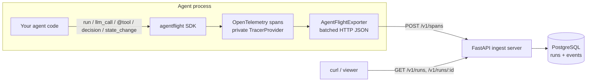

# AgentFlight

A black box recorder for AI agents. AgentFlight records what an agent does during a run:
model calls, tool executions, decisions, state changes, token spend and failures. Every run
is stored as an ordered timeline you can query, replay and fork.

> Status: early development (week 4, replay and fork). APIs may change.

## Architecture



- **One run = one OpenTelemetry trace.** `agentflight.run(...)` opens the root span; its
  trace id is the run id. Everything recorded inside it is a child span.
- **Each span carries `agentflight.*` attributes** (`kind`, model, messages, tokens, tool
  args/result, error type...). Structured values are stored as JSON.
- The SDK uses its **own TracerProvider**, so it doesn't change any global OTel setup your
  app already has.
- The server **upserts by span id** (re-sent batches are idempotent) and accepts child spans
  before their root span arrives (the run shows as `running` until then).
- **Run totals are stored on the run row** (calls, errors, tokens, cost) and recomputed in
  SQL for every run an ingest batch touches, so listing runs never reads their events and
  re-sent spans can't make the totals drift.

## Quickstart

```bash
# 0. A key for the server and the SDK (never commit it)
export AGENTFLIGHT_API_KEY=$(openssl rand -hex 32)

# 1. Server + Postgres + retention job (applies Alembic migrations on start)
docker compose up --build

# or without Docker, using SQLite:
pip install -e ".[server]"
alembic upgrade head            # uses AGENTFLIGHT_DATABASE_URL, default sqlite:///./agentflight.db
uvicorn agentflight.server.main:app

# 2. Record the toy agent (the SDK reads AGENTFLIGHT_API_KEY)
pip install -e .
python examples/toy_agent.py

# 3. Inspect
curl -H "Authorization: Bearer $AGENTFLIGHT_API_KEY" localhost:8000/v1/runs
curl -H "Authorization: Bearer $AGENTFLIGHT_API_KEY" localhost:8000/v1/runs/<run_id>
```

## Recording API

```python
import agentflight

agentflight.configure("http://localhost:8000")


@agentflight.tool  # records name, bound args, result or exception
def search(query: str) -> list[str]: ...


with agentflight.run("support-agent", metadata={"ticket": 42}) as run:
    with agentflight.llm_call("gpt-4o-mini", messages) as call:
        resp = client.chat(...)  # your model client
        call.record(resp.text, tokens_in=..., tokens_out=..., cost_usd=...)  # cost optional
    agentflight.decision("next_step", "search", reason="needs docs")
    agentflight.state_change("plan", new_plan, old=old_plan)
    try:
        search("refund policy")
    except Exception as exc:
        agentflight.error(exc)  # handled error: recorded, run continues

agentflight.flush()  # before exit, so batched spans are sent
```

- Latency is the span duration (`duration_ms` in the API).
- An exception escaping `run`, `llm_call` or a `@tool` marks that span (and the run) as
  `error` and is re-raised unchanged.
- `@agentflight.tool` works on sync and async functions; `@agentflight.tool(name="...")`
  overrides the name.
- If the server is unreachable, export fails with a logged warning; your agent keeps running.

## Integrations

Optional extras; the core SDK depends on neither package.

### OpenAI-style chat clients

```bash
pip install "agentflight[openai]"
```

```python
from openai import OpenAI
from agentflight.integrations.openai import instrument_openai

client = instrument_openai(OpenAI())  # same client, now recorded
with agentflight.run("support-agent"):
    resp = client.chat.completions.create(model="gpt-4o-mini", messages=msgs, tools=tools)
```

- Each `chat.completions.create` call is an `llm` span with the model, messages, request
  params (`tools`, `temperature`, ...), the full response (tool calls included) and
  `tokens_in`/`tokens_out` from `response.usage`.
- Works with `OpenAI` and `AsyncOpenAI`, and with any client that has the same
  `client.chat.completions.create(model=..., messages=...)` shape. `openai` itself is never
  imported by AgentFlight.
- Cost isn't guessed. There's no built-in price table, so pass
  `instrument_openai(client, cost=lambda model, tokens_in, tokens_out: ...)` if you want it.
- `extra_headers`, `extra_query`, `extra_body` and `timeout` are passed to the client but
  never recorded (headers can carry credentials). Everything recorded goes through your
  `redact` hook.
- Fail-open: the call happens exactly once with your arguments and its response or
  exception comes back unchanged. If response parsing or your `cost` function fails, that's
  logged and ignored. A client without the expected shape is returned untouched.
- **Not recorded yet:** `stream=True` calls (passed straight through) and the Responses API.

### LangGraph

```bash
pip install "agentflight[langgraph]"
```

```python
from agentflight.integrations.langgraph import AgentFlightCallbackHandler

handler = AgentFlightCallbackHandler(run_name="react-agent")
graph.invoke(inputs, config={"callbacks": [handler]})
print(handler.run_id)
```

- The graph becomes a `run`. Inside an `agentflight.run(...)` it's a `node` span in that run
  instead. Each executed node is a `node` span with `agentflight.node.name`, `.step`,
  `.input` (state in) and `.output` (state update).
- Chat model and LLM calls inside nodes are `llm` spans (messages, params, response, token
  usage from `usage_metadata` or `token_usage`). LangChain tools are `tool` spans. So
  `create_react_agent`-style graphs record without any SDK calls in your code.
- LangChain's own runnables inside a node (prompts, sequences, routers) aren't recorded.
  Their children attach to the nearest recorded span.
- Errors are recorded where they happen and share one failure id up the graph. LangGraph
  interrupts aren't errors: the node's output records `{"interrupted": ...}`.
- Params whose names contain `api_key`, `secret`, `password` or `authorization` are dropped.
- Fail-open: every callback is guarded, so a broken recorder never changes the graph's
  result or exception.
- **Limitation:** spans you record yourself inside a node (`@agentflight.tool`,
  `llm_call`) attach to the surrounding `agentflight.run`, not to the node span, and are
  only part of a run if one is open.

Both examples run offline (scripted model, no API key needed):

```bash
python examples/openai_agent.py      # uses the real API if OPENAI_API_KEY is set
python examples/langgraph_agent.py
```

## Replay and fork

Re-run an agent against a recorded run. Recorded model and tool outputs are served instead of
calling anything, so a replay costs nothing and gives the same result. A fork replays up to
a step, then runs live from there.

```python
recording = agentflight.Recording.fetch(run_id)  # or Recording.load("run.json")
for step in recording.steps:
    print(step.index, step.kind, step.name)  # 0 llm gpt-4o-mini, 1 tool search, ...

with agentflight.replay(recording) as session:
    answer = my_agent(question)  # same code as the recorded run
assert session.remaining == 0  # the replay covered every recorded step

with agentflight.fork(recording, at=1, output="no results"):
    answer = my_agent(question)  # step 0 cached, step 1 returns "no results", rest live

with agentflight.fork(recording, at=2):
    answer = my_agent(question)  # steps 0-1 cached, live from step 2 (e.g. a changed prompt)
```

**Steps.** A step is one `@agentflight.tool` call or one model call (`instrument_openai`, or
an `llm_call` block), in the order recorded. A call made inside another step (say, a model
call inside a tool) is part of that step. Serving the outer call means the inner one
never runs.

**What gets intercepted.** Only these calls are intercepted:

- `@agentflight.tool` functions: the recorded result is returned and the function doesn't
  run.
- Clients wrapped with `instrument_openai`: the client isn't called. The recorded response
  comes back as an `openai` `ChatCompletion` (or as a dict with attribute access if
  `openai` isn't installed).
- Manual `llm_call` blocks, only if your code checks `call.replayed`:

  ```python
  with agentflight.llm_call(model, messages) as call:
      if call.replayed:
          reply = call.response
      else:
          reply = client.chat(...)
          call.record(reply, tokens_in=..., tokens_out=...)
  ```

**What replay guarantees:**

- Each intercepted call is checked against its recorded step: the same kind, the same
  model or tool name, and the same inputs (messages and params, or bound tool arguments).
  Inputs are compared after the same redaction and truncation that was used for recording.
  Any mismatch, or a call beyond the end of the recording, raises `ReplayDivergence`
  naming the step and the field. Values are never included in the error.
- By default, replay never falls back to a live call. If a step can't be served, it
  raises (unlike recording, which is fail-open). A recorded failure is re-raised. Built-in exception types
  (`LookupError`, `ValueError`...) come back as that type with the recorded message. Other
  types raise `ReplayedError`, which carries `error_type` and `message`.
- A replay or fork is recorded as a new run. Its run carries
  `agentflight.replay.source_run`, `.mode` (`replay`/`fork`) and `.fork_step`. Each step span
  carries `agentflight.replay.step` and `agentflight.replay.source` (`cached`, `override`
  or `live`). Cached calls record no tokens or cost, because nothing was spent.

**Going live on divergence (opt-in).** `replay(recording, on_divergence="live")` and
`fork(..., on_divergence="live")` don't raise on the first mismatch. Instead they stop
serving recorded outputs: that step and every later call run live, and the steps are marked
`live`. The step and the reason are recorded on the session (`session.diverged_at`,
`session.divergence`), on the innermost open run as `agentflight.replay.diverged_at` and
`agentflight.replay.divergence`, and in a warning on the `agentflight` logger.

```python
with agentflight.replay(recording, on_divergence="live") as session:
    answer = my_agent(new_question)
print(session.diverged_at)  # e.g. 0: the first model call already differed
```

- This makes real model and tool calls from the divergence point on, so use it only
  where that's acceptable.
- Only mismatches switch to live. That covers a different kind, name or input, or a call
  beyond the recording. A step whose recorded output was truncated still raises
  `ReplayError`, and a recorded failure is still re-raised.

**What it doesn't guarantee:**

- **Only intercepted calls are replayed.** Raw HTTP, database queries, file reads, the
  clock or randomness inside your agent still run live. Replay only catches them
  indirectly: if they change the input of a later step, that step diverges.
- **Outputs come back as recorded JSON.** Tuples come back as lists, and custom objects
  come back as whatever was recorded (often a `repr` string). Redacted values come back
  redacted. A step whose recorded output was truncated raises `ReplayError` instead of
  returning a partial value. If an input was truncated, only the stored prefix is
  compared.
- **Use the same `redact` hook** (and `max_attr_chars`) as when recording, or the inputs
  won't match.
- **Sequential agents only.** Steps are matched in recorded order. Calls made in parallel
  threads or tasks can come in a different order and diverge. The replay is bound to the
  current context (a `ContextVar`): asyncio tasks started inside it see it, but new threads
  don't.
- **Not covered yet:** LangGraph runs (their model and tool calls go through LangChain,
  which can't be intercepted yet; LangGraph's own checkpointer time travel covers some of
  this) and streamed OpenAI calls.

`python examples/replay_agent.py` records the toy agent, replays it and forks it at the
tool step (needs the server running).

## Failure isolation

AgentFlight follows one rule: **observability must never become a dependency for
successful agent execution.** `tests/test_failure_isolation.py` checks each guarantee.

Guarantees:

- **Return values and exceptions pass through unchanged.** `run`, `llm_call` and `@tool`
  return what your code returns and re-raise your exact exception object, even if
  recording that exception fails.
- **Recorder failures never raise into agent code.** Each of these is caught and logged as a
  warning on the `agentflight` logger: the server being down, HTTP 4xx/5xx, redirects,
  malformed or truncated responses, transport exceptions, timeouts, exceptions from the
  exporter's `export` / `force_flush` / `shutdown`, exceptions from span processor hooks,
  and a broken tracer or serializer. If a span can't be opened, your code still runs under
  a non-recording span.
- **Weird payloads are safe.** Payloads that JSON can't serialize fall back to `repr`.
  If `repr` itself raises, the value is stored as `<unrepresentable Type>`. This covers
  circular structures, `NaN`, bytes, locks, generators and objects whose `__repr__` or
  `__str__` raise. Values are cut off at 32,000 characters.
- **No blocking in the default mode.** With `batch=True` (the default), spans are exported
  on a background thread, so a hanging server doesn't slow the agent down.
- **Bounded waits.** `flush(timeout_millis=...)` and `shutdown()` never raise. They wait at
  most about the given flush timeout plus the exporter's HTTP timeout (`configure(...,
  timeout=5.0)`). Interpreter exit is also clean: AgentFlight replaces OpenTelemetry's
  atexit hook with a fail-safe one.
- **A bad configuration disables recording instead of raising.**

Limitations (known, not yet handled):

- **Lost spans.** If export fails, those spans are dropped. There's no retry, no disk
  buffer and no dead-letter queue yet. If the server is unreachable, the run is simply
  missing from the recording.
- **The batch queue is bounded.** OpenTelemetry's default limit is 2048 spans. When the
  queue is full, new spans are dropped rather than blocking the agent.
- **`batch=False` blocks.** It exports inside the agent's thread, so each span can block
  for up to the HTTP timeout. Use it only for tests or debugging.
- **A partly broken span processor can mis-parent later spans.** If a processor fails while
  a span is closing, the current-span context may not be restored. The agent still runs,
  but later spans in that run may be attached to the wrong parent.
- **Custom exporters must honor timeouts.** If you write a custom exporter
  that blocks forever (ignoring timeouts), only `flush`/`shutdown` timeouts protect you.
- **`BaseException`s are recorded and re-raised.** `KeyboardInterrupt` and `SystemExit` are
  never swallowed. Only ordinary `Exception`s raised by the instrumentation are suppressed.

## Errors and failures

Each run summary has two error numbers:

- `errors` is the number of **distinct logical failures**.
- `error_events` is the number of events with error status.

Every error event carries `agentflight.failure.id`. The id follows the exception object, so
a tool raising `LookupError`, the agent calling `agentflight.error(exc)` on it, and the run
failing with it all share one id and count as **one** failure. An exception raised while
handling a recorded one (`raise X from exc`, or inside its `except`) inherits that id.
Independent exceptions get new ids and count separately. Every event is still stored.
Error events from SDKs that don't send ids count one each.

## Payload size and redaction

```python
agentflight.configure(
    max_attr_chars=32_000,  # per payload; None disables the cap
    redact=agentflight.redact_fields("api_key", "password", "authorization"),
)
```

- **Truncation is explicit.** A payload (messages, response, tool args/result, metadata,
  decision choice, state) longer than `max_attr_chars` is cut to that length. Its key is then
  listed in the span's `agentflight.truncated` attribute, and in the API's per-event
  `truncated` field, as
  `{"original_length": ..., "stored_length": ..., "reason": "exceeds max_attr_chars=..."}`.
  So you can always tell a truncated recording from the original message. The limit is a
  storage limit, not a model context limit.
- **Redaction.** `redact(key, value)` runs on every payload before it is serialized, and
  `key` is the attribute name (for example `agentflight.tool.args`). `redact_fields(...)`
  masks dict entries with those names (case-insensitive) at any depth. If your hook
  raises, the value is replaced with `"<redaction failed>"`; it fails closed and nothing is
  recorded.
- **Not covered yet:** exception messages and stack traces, run and tool names, and model
  names aren't passed through the hook.

## Authentication

The server **requires an API key by default** and refuses to start without one.

| Setting | Meaning |
| --- | --- |
| `AGENTFLIGHT_API_KEY` | A key with every permission. Clients send `Authorization: Bearer <key>` (or `X-AgentFlight-Key`). |
| `AGENTFLIGHT_API_KEYS` | Scoped keys: comma-separated `<key>:<permission>[+<permission>...]`, e.g. `k1:ingest,k2:read,k3:read+delete`. |
| `AGENTFLIGHT_AUTH_DISABLED=true` | Explicit opt-out for local development only. A warning is logged at startup. |

The server starts if at least one of `AGENTFLIGHT_API_KEY` and `AGENTFLIGHT_API_KEYS` is
set. Give recorders an `ingest`-only key, so a leaked agent key can't read or delete
history, and give people and dashboards a `read` key.

- Keys are compared in constant time (`hmac.compare_digest`). Wrong or missing keys get
  `401`, and the response never echoes the key.
- Endpoints require an `ingest`, `read` or `delete` permission. A valid key without the
  needed permission gets `403`. A malformed `AGENTFLIGHT_API_KEYS` (unknown permission,
  duplicate key) stops the server at startup, and the error never includes the key.
- `Authorization` and `X-AgentFlight-Key` are never logged. `redact_headers()` is the
  helper for anything that logs headers, and a log filter on the server's loggers scrubs the
  configured keys from any message as a backstop.
- **SDK:** `configure(api_key=...)`, or the `AGENTFLIGHT_API_KEY` environment variable.
  If the server rejects the key, the SDK logs one warning (without the key) and drops the
  spans. The agent keeps running.
- `/health` and `/ready` are unauthenticated so orchestrators can probe them.

## Retention and deletion

| Setting | Default |
| --- | --- |
| `AGENTFLIGHT_RETENTION_ENABLED` | `true` |
| `AGENTFLIGHT_RETENTION_DAYS` | `30` |
| `AGENTFLIGHT_CLEANUP_INTERVAL_HOURS` | `24` |

```bash
agentflight-server cleanup --dry-run    # count runs older than the retention period
agentflight-server cleanup              # delete them (and all their events)
agentflight-server cleanup --days 7     # one-off override
agentflight-server cleanup --loop       # repeat every CLEANUP_INTERVAL_HOURS (Compose runs this)
```

A run's age is measured from when it ended, or from when it started if it never finished.
Runs with no timestamps are kept. `DELETE /v1/runs/{id}` (which needs the `delete`
permission) removes a single run with all its events, including the messages and tool
payloads stored on them.

## HTTP API

| Method | Path | Permission | Description |
| --- | --- | --- | --- |
| `POST` | `/v1/spans` | ingest | Ingest a batch of spans (`{"spans": [...]}`) |
| `GET` | `/v1/runs` | read | List runs, newest first (`limit`, `offset`, `status`) with token/cost/error totals |
| `GET` | `/v1/runs/{run_id}` | read | One run with its events ordered by start time |
| `DELETE` | `/v1/runs/{run_id}` | delete | Delete a run and all its events (`204`, or `404`) |
| `GET` | `/health` | none | Liveness (process is up) |
| `GET` | `/ready` | none | Readiness (database reachable and migrated); 503 otherwise |

Interactive docs at `/docs` when the server is running.

## Development

```bash
python -m venv .venv && . .venv/bin/activate
pip install -e ".[dev]"
ruff check . && ruff format --check . && mypy && pytest
```

Tests use in-memory SQLite by default. Set `AGENTFLIGHT_TEST_DATABASE_URL` to a Postgres URL
to run the same suite against Postgres (CI does both).

CI also runs a Compose smoke test with a throwaway key. It brings up
`docker compose up --wait` (Postgres plus the server, both health-checked) and runs
`scripts/compose_smoke.py`, which checks that:

- missing and wrong keys are rejected;
- the toy agent still completes with a wrong key, and nothing is persisted;
- with the right key, both runs are persisted with the expected token, cost and
  (deduplicated) error totals;
- `DELETE` removes a run.

The stack is always torn down afterwards. You can run it locally:

```bash
export AGENTFLIGHT_API_KEY=$(openssl rand -hex 32)
docker compose up --build --wait
python scripts/compose_smoke.py
docker compose down --volumes
```

## Roadmap

- **Week 1: recorder core** (done): SDK, OTel exporter, ingest API, Postgres storage,
  migrations, failure isolation, tests, CI with a Compose smoke test.
- **Week 2: hardening** (done): logical failure counting, API-key auth, retention
  and deletion, explicit truncation and redaction.
- **Week 3: integrations** (done): OpenAI-style chat client instrumentation (usage from
  responses) and a LangGraph callback handler, with offline example agents.
  Deferred: streaming and the Responses API.
- **Week 4: deterministic replay and fork** (this branch): replay a recorded run from
  cached model and tool outputs with divergence checks, and fork from any step with a
  substituted output or changed code. Deferred: LangGraph replay, streamed calls,
  parallel tool calls, a server-side "fork" endpoint.
- **Week 5: React viewer and benchmarks.** Run timeline, decision tree, token spend and
  highlighted failures; README screenshots; recorder overhead measured on real runs and
  published with the method used.

## License

MIT
