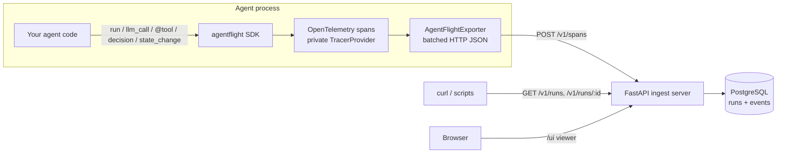
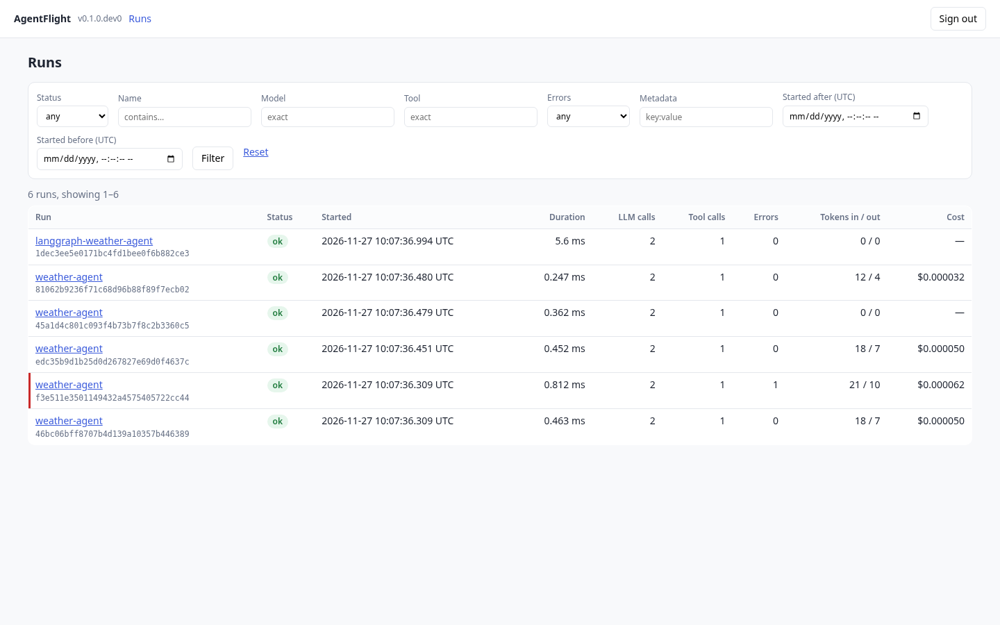
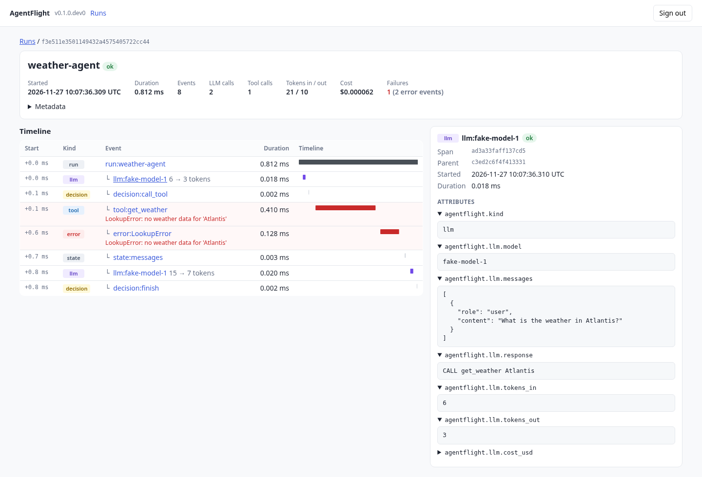
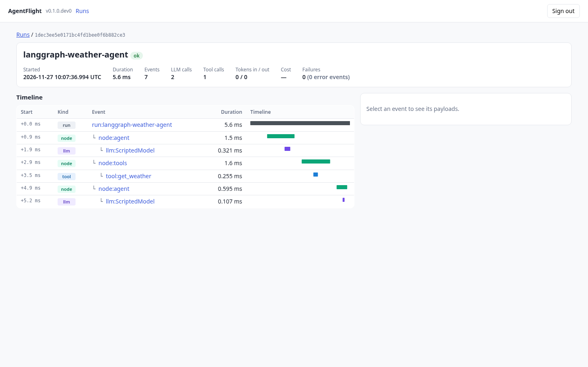
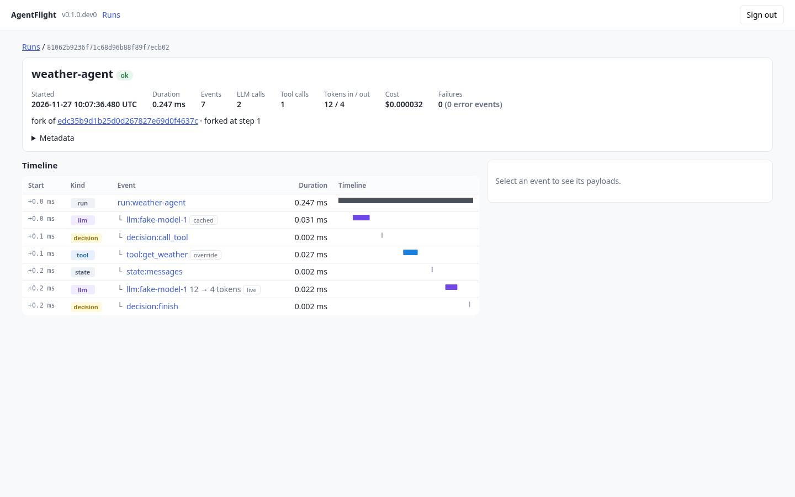

# AgentFlight

A black box recorder for AI agents. AgentFlight records what an agent does during a run:
model calls, tool executions, decisions, state changes, token spend and failures. Every run
is stored as an ordered timeline you can query, replay and fork.

> Status: early development (week 5, viewer). APIs may change; see [CHANGELOG.md](CHANGELOG.md).

## AgentFlight, Langfuse, LangSmith or Phoenix?

[Langfuse](https://langfuse.com/docs), [LangSmith](https://docs.langchain.com/langsmith/home)
and [Arize Phoenix](https://arize.com/docs/phoenix) are full LLM engineering platforms.
Besides tracing they offer evaluations, datasets and experiments, prompt management and
dashboards, with many framework and provider integrations. Langfuse and Phoenix can be
self-hosted and accept OpenTelemetry traces. LangSmith runs as a LangChain cloud service,
with self-hosted and bring-your-own-cloud options on its Enterprise plan.

AgentFlight is much smaller: a Python recorder, one server on Postgres (or SQLite) and a
read-only viewer, with no evaluations, prompt management or dashboards. Its focus is
re-running your own agent code from a recording. [Replay](#replay-and-fork) serves the
recorded model and tool outputs back to the same code in your process, offline, and fork
swaps one step and runs live from there. That's different from re-running a single LLM
call in a playground (Phoenix's span replay, for example, replays LLM calls with different
inputs). Choose one of the platforms if you need evaluations, prompt management or team
features; AgentFlight if you want a small self-hosted recorder with step-by-step replay
of agent runs.

## Architecture



- **One run = one OpenTelemetry trace.** `agentflight.run(...)` opens the root span; its
  trace id is the run id. Everything recorded inside it is a child span.
- **Each span carries `agentflight.*` attributes** (`kind`, model, messages, tokens, tool
  args/result, error type...). Structured values are stored as JSON.
- The SDK uses its **own TracerProvider**, so it doesn't change any global OTel setup your
  app already has.
- The server **upserts by span id** (re-sent batches are idempotent) and accepts child spans
  before their root span arrives (the run shows as `running` until then; see
  [Run status](#run-status)).
- **Run totals are stored on the run row** (calls, errors, tokens, cost) and recomputed in
  SQL for every run an ingest batch touches, so listing runs never reads their events and
  re-sent spans can't make the totals drift.

## Quickstart

```bash
# 0. A key for the server and the SDK (never commit it)
export AGENTFLIGHT_API_KEY=$(openssl rand -hex 32)

# 1. Server + Postgres + retention job (applies Alembic migrations on start)
docker compose up --build

# or without Docker, using SQLite:
pip install -e ".[server]"
agentflight-server migrate      # uses AGENTFLIGHT_DATABASE_URL, default sqlite:///./agentflight.db
agentflight-server serve        # http://127.0.0.1:8000

# 2. Record the toy agent (the SDK reads AGENTFLIGHT_API_KEY)
pip install -e .
python examples/toy_agent.py

# 3. Inspect: open http://localhost:8000/ui and sign in with the key, or use the API
curl -H "Authorization: Bearer $AGENTFLIGHT_API_KEY" localhost:8000/v1/runs
curl -H "Authorization: Bearer $AGENTFLIGHT_API_KEY" localhost:8000/v1/runs/<run_id>
```

## Viewer

The server includes a read-only viewer at `/ui`:

- **Runs:** every run with its status, start time, duration, call counts, failures, tokens
  and cost, filtered by status, name, model, tool, errors, metadata (`key:value`) and start
  time. Filters update the table in place. A run whose recorder dropped spans is marked
  "incomplete recording: N spans dropped" (see "Dropped spans are counted" below).
- **Run page:** the run's spans as an indented tree (each span under its parent,
  siblings in start order) with a bar per span on the run's time axis, failures
  highlighted with their messages, and replay/fork runs linked to the run they came
  from. A span whose parent never arrived starts its own subtree at the left. Events load
  in pages of 100 without payloads, and the next page continues the tree where the last
  one stopped; selecting an event loads its messages, outputs, arguments and stack traces
  on demand. An incomplete recording gets a warning above the timeline. (To page in tree order the server reads every span's id and parent for each
  page, which is cheap next to loading the events themselves.)









The screenshots come from the browser smoke test against the example agents; regenerate
them with `AGENTFLIGHT_SCREENSHOT_DIR=docs/screenshots pytest tests/test_viewer_browser.py`.

It is server-rendered (Jinja2 and [htmx](https://htmx.org), vendored, no build step) and
reads through the same service functions and JSON shapes as the `/v1` API, so another
frontend can be built on the API alone. Everything a run recorded is treated as untrusted:
templates autoescape everything and nothing is marked safe, and pages are served with a
Content-Security-Policy that allows no inline script or style (`script-src 'self'`). See
[Viewer sign-in](#viewer-sign-in) for how sessions work.

## Recording API

```python
import agentflight

agentflight.configure("http://localhost:8000")


@agentflight.tool  # records name, bound args, result or exception
def search(query: str) -> list[str]: ...


with agentflight.run("support-agent", metadata={"ticket": 42}) as run:
    with agentflight.llm_call("gpt-4o-mini", messages) as call:
        resp = client.chat(...)  # your model client
        call.record(resp.text, tokens_in=..., tokens_out=..., cost_usd=...)  # cost optional
    agentflight.decision("next_step", "search", reason="needs docs")
    agentflight.state_change("plan", new_plan, old=old_plan)
    try:
        search("refund policy")
    except Exception as exc:
        agentflight.error(exc)  # handled error: recorded, run continues

agentflight.flush()  # before exit, so batched spans are sent
```

- Latency is the span duration (`duration_ms` in the API).
- An exception escaping `run`, `llm_call` or a `@tool` marks that span (and the run) as
  `error` and is re-raised unchanged.
- `@agentflight.tool` works on sync and async functions; `@agentflight.tool(name="...")`
  overrides the name.
- If the server is unreachable, export fails with a logged warning; your agent keeps running.

## Integrations

Optional extras; the core SDK depends on neither package.

### OpenAI-style chat clients

```bash
pip install "agentflight[openai]"
```

```python
from openai import OpenAI
from agentflight.integrations.openai import instrument_openai

client = instrument_openai(OpenAI())  # same client, now recorded
with agentflight.run("support-agent"):
    resp = client.chat.completions.create(model="gpt-4o-mini", messages=msgs, tools=tools)
```

- Each `chat.completions.create` call is an `llm` span with the model, messages, request
  params (`tools`, `temperature`, ...), the full response (tool calls included) and
  `tokens_in`/`tokens_out` from `response.usage`.
- Works with `OpenAI` and `AsyncOpenAI`, and with any client that has the same
  `client.chat.completions.create(model=..., messages=...)` shape. `openai` itself is never
  imported by AgentFlight.
- Cost isn't guessed. There's no built-in price table, so pass
  `instrument_openai(client, cost=lambda model, tokens_in, tokens_out: ...)` if you want it.
- `extra_headers`, `extra_query`, `extra_body` and `timeout` are passed to the client but
  never recorded (headers can carry credentials). Everything recorded goes through your
  `redact` hook.
- Fail-open: the call happens exactly once with your arguments and its response or
  exception comes back unchanged. If response parsing or your `cost` function fails, that's
  logged and ignored. A client without the expected shape is returned untouched.
- **Not recorded yet:** `stream=True` calls (passed straight through) and the Responses API.

### LangGraph

```bash
pip install "agentflight[langgraph]"
```

```python
from agentflight.integrations.langgraph import AgentFlightCallbackHandler

handler = AgentFlightCallbackHandler(run_name="react-agent")
graph.invoke(inputs, config={"callbacks": [handler]})
print(handler.run_id)
```

- The graph becomes a `run`. Inside an `agentflight.run(...)` it's a `node` span in that run
  instead. Each executed node is a `node` span with `agentflight.node.name`, `.step`,
  `.input` (state in) and `.output` (state update).
- Chat model and LLM calls inside nodes are `llm` spans (messages, params, response, token
  usage from `usage_metadata` or `token_usage`). LangChain tools are `tool` spans. So
  `create_react_agent`-style graphs record without any SDK calls in your code.
- LangChain's own runnables inside a node (prompts, sequences, routers) aren't recorded.
  Their children attach to the nearest recorded span.
- Errors are recorded where they happen and share one failure id up the graph. LangGraph
  interrupts aren't errors: the node's output records `{"interrupted": ...}`.
- Params whose names contain `api_key`, `secret`, `password` or `authorization` are dropped.
- Fail-open: every callback is guarded, so a broken recorder never changes the graph's
  result or exception.
- **Limitation:** spans you record yourself inside a node (`@agentflight.tool`,
  `llm_call`) attach to the surrounding `agentflight.run`, not to the node span, and are
  only part of a run if one is open.

Both examples run offline (scripted model, no API key needed):

```bash
python examples/openai_agent.py      # uses the real API if OPENAI_API_KEY is set
python examples/langgraph_agent.py
```

## Replay and fork

Re-run an agent against a recorded run. Recorded model and tool outputs are served instead of
calling anything, so a replay costs nothing and gives the same result. A fork replays up to
a step, then runs live from there.

**Know the limits first:**

- **Only intercepted calls are replayed.** Replay suits agents that only call models and
  tools. File writes, database queries, raw HTTP, the clock and randomness inside your
  agent still run live during a replay. Replay only notices them indirectly, when they
  change the input of a later step and that step diverges.
- **An incomplete recording can't replay faithfully.** If the recorder dropped spans of
  the run (full export queue), `replay()` and `fork()` log a warning as they start, before
  any step runs, and `Recording.incomplete` / `Recording.dropped_spans` say so. Missing
  steps then show up as divergences, or as live calls with `on_divergence="live"`.
- **Not covered yet:** LangGraph runs (their model and tool calls go through LangChain,
  which can't be intercepted yet; LangGraph's own checkpointer time travel covers some of
  this) and streamed OpenAI calls (`stream=True`).
- **Sequential agents only.** Steps are matched in recorded order, so calls made in
  parallel threads or tasks can come in a different order and diverge.

```python
recording = agentflight.Recording.fetch(run_id)  # or Recording.load("run.json")
for step in recording.steps:
    print(step.index, step.kind, step.name)  # 0 llm gpt-4o-mini, 1 tool search, ...

with agentflight.replay(recording) as session:
    answer = my_agent(question)  # same code as the recorded run
assert session.remaining == 0  # the replay covered every recorded step

with agentflight.fork(recording, at=1, output="no results"):
    answer = my_agent(question)  # step 0 cached, step 1 returns "no results", rest live

with agentflight.fork(recording, at=2):
    answer = my_agent(question)  # steps 0-1 cached, live from step 2 (e.g. a changed prompt)
```

**Steps.** A step is one `@agentflight.tool` call or one model call (`instrument_openai`, or
an `llm_call` block), in the order recorded. A call made inside another step (say, a model
call inside a tool) is part of that step. Serving the outer call means the inner one
never runs.

**What gets intercepted.** Only these calls are intercepted:

- `@agentflight.tool` functions: the recorded result is returned and the function doesn't
  run.
- Clients wrapped with `instrument_openai`: the client isn't called. The recorded response
  comes back as an `openai` `ChatCompletion` (or as a dict with attribute access if
  `openai` isn't installed).
- Manual `llm_call` blocks, only if your code checks `call.replayed`:

  ```python
  with agentflight.llm_call(model, messages) as call:
      if call.replayed:
          reply = call.response
      else:
          reply = client.chat(...)
          call.record(reply, tokens_in=..., tokens_out=...)
  ```

**What replay guarantees:**

- Each intercepted call is checked against its recorded step: the same kind, the same
  model or tool name, and the same inputs (messages and params, or bound tool arguments).
  Inputs are compared after the same redaction and truncation that was used for recording.
  Any mismatch, or a call beyond the end of the recording, raises `ReplayDivergence`
  naming the step and the field. Values are never included in the error.
- By default, replay never falls back to a live call. If a step can't be served, it
  raises (unlike recording, which is fail-open). A recorded failure is re-raised. Built-in exception types
  (`LookupError`, `ValueError`...) come back as that type with the recorded message. Other
  types raise `ReplayedError`, which carries `error_type` and `message`.
- A replay or fork is recorded as a new run. Its run carries
  `agentflight.replay.source_run`, `.mode` (`replay`/`fork`) and `.fork_step`. Each step span
  carries `agentflight.replay.step` and `agentflight.replay.source` (`cached`, `override`
  or `live`). Cached calls record no tokens or cost, because nothing was spent.

**Going live on divergence (opt-in).** `replay(recording, on_divergence="live")` and
`fork(..., on_divergence="live")` don't raise on the first mismatch. Instead they stop
serving recorded outputs: that step and every later call run live, and the steps are marked
`live`. The step and the reason are recorded on the session (`session.diverged_at`,
`session.divergence`), on the innermost open run as `agentflight.replay.diverged_at` and
`agentflight.replay.divergence`, and in a warning on the `agentflight` logger.

```python
with agentflight.replay(recording, on_divergence="live") as session:
    answer = my_agent(new_question)
print(session.diverged_at)  # e.g. 0: the first model call already differed
```

- This makes real model and tool calls from the divergence point on, so use it only
  where that's acceptable.
- Only mismatches switch to live. That covers a different kind, name or input, or a call
  beyond the recording. A step whose recorded output was truncated still raises
  `ReplayError`, and a recorded failure is still re-raised.

**What it doesn't guarantee:**

- **Only intercepted calls are replayed** (see the limits above).
- **Outputs come back as recorded JSON.** Tuples come back as lists, and custom objects
  come back as whatever was recorded (often a `repr` string). Redacted values come back
  redacted. A step whose recorded output was truncated raises `ReplayError` instead of
  returning a partial value. If an input was truncated, only the stored prefix is
  compared.
- **Use the same `redact` hook** (and `max_attr_chars`) as when recording, or the inputs
  won't match.
- **Sequential agents only** (see above). The replay is bound to the current context (a
  `ContextVar`): asyncio tasks started inside it see it, but new threads don't.

`python examples/replay_agent.py` records the toy agent, replays it and forks it at the
tool step (needs the server running).

## Failure isolation

AgentFlight follows one rule: **observability must never become a dependency for
successful agent execution.** `tests/test_failure_isolation.py` checks each guarantee.

Guarantees:

- **Return values and exceptions pass through unchanged.** `run`, `llm_call` and `@tool`
  return what your code returns and re-raise your exact exception object, even if
  recording that exception fails.
- **Recorder failures never raise into agent code.** Each of these is caught and logged as a
  warning on the `agentflight` logger: the server being down, HTTP 4xx/5xx, redirects,
  malformed or truncated responses, transport exceptions, timeouts, exceptions from the
  exporter's `export` / `force_flush` / `shutdown`, exceptions from span processor hooks,
  and a broken tracer or serializer. If a span can't be opened, your code still runs under
  a non-recording span.
- **Weird payloads are safe.** Payloads that JSON can't serialize fall back to `repr`.
  If `repr` itself raises, the value is stored as `<unrepresentable Type>`. This covers
  circular structures, `NaN`, bytes, locks, generators and objects whose `__repr__` or
  `__str__` raise. Values are cut off at 32,000 characters.
- **No blocking in the default mode.** With `batch=True` (the default), spans are exported
  on a background thread, so a hanging server doesn't slow the agent down.
- **Run spans skip the queue.** A run's root span (the one that closes the run and
  carries its status and drop count) doesn't go through the bounded batch queue. It goes
  to a lane of its own, which a dedicated thread sends as soon as the run ends, several at
  a time if runs end together. So a run whose other spans were dropped still closes on
  the server instead of staying `running` and later showing as `abandoned`. Ending a run
  only appends the span to that lane under a lock; the agent thread never waits on the
  network. Each send has a deadline: no request starts after it, and each request's
  timeouts are capped to what is left of it (the exporter's `timeout`, 5 s by default).
  It's still best effort and fail-open: if the send fails or runs out of time, the run
  span is lost like any failed export (and the run can end up `abandoned`), and if more
  than 1,024 run spans are waiting, new ones are dropped and counted. Each run span is
  handed to the exporter once, never to both the lane and the queue. The exporter is
  only ever called by one thread at a time, so a run span can wait for a batch that is
  being sent. `flush()` and `shutdown()` wait for the lane too, within their timeouts.
- **Bounded waits.** `flush(timeout_millis=30_000)` and `shutdown(timeout_millis=30_000)`
  never raise and return within their timeout. AgentFlight enforces this itself, because
  OpenTelemetry's isn't reliable: in opentelemetry-sdk 1.45, `force_flush(300)` against a
  hanging server with four batches queued took 4.0 s (one 1 s HTTP timeout per batch).
  When the wait runs out, `flush()` returns `False` and export carries on in the
  background; whatever `shutdown()` hasn't sent by then is lost. Interpreter exit is also
  clean: AgentFlight replaces OpenTelemetry's atexit hook with a fail-safe one, bounded
  the same way.
- **A bad configuration disables recording instead of raising.**

Limitations (known, not yet handled):

- **Lost spans.** If export fails, those spans are dropped. There's no retry, no disk
  buffer and no dead-letter queue yet. If the server is unreachable, the run is simply
  missing from the recording.
- **The batch queue is bounded.** It holds 2048 finished spans by default; set it with
  `configure(max_queue_size=...)` or `AGENTFLIGHT_MAX_QUEUE_SIZE` (OpenTelemetry's
  `OTEL_BSP_MAX_QUEUE_SIZE` also works). When the queue is full, spans are dropped rather
  than blocking the agent. A bigger queue absorbs longer bursts at the cost of memory
  (each queued span holds its payloads, up to `max_attr_chars` each).
- **Dropped spans are counted, on a best-effort basis.** AgentFlight checks the queue
  itself before handing a span to OpenTelemetry, so it knows every span it drops (on its
  own, OpenTelemetry 1.45 drops the *oldest* queued span, which can belong to another
  run). When a run ends, the spans of that run dropped so far go on the run span as
  `agentflight.run.dropped_spans`, and the viewer and replay warn about it. Run spans
  skip the queue (see "Run spans skip the queue"), so the span carrying the count isn't
  competing with the spans it counts. What this can't cover: spans of the run that end
  *after* the run span (background threads or tasks still running), a run span dropped
  because more than 1,024 were waiting to be sent, and spans lost later in export
  (server down, see "Lost spans"). Those are only in the recorder's
  total, `agentflight.get_recorder().dropped_spans`, and a warning is logged on the first
  drop. `batch=False` has no queue and never drops this way.
- **`batch=False` blocks.** It exports inside the agent's thread, so each span can block
  for up to the HTTP timeout. Use it only for tests or debugging.
- **A partly broken span processor can mis-parent later spans.** If a processor fails while
  a span is closing, the current-span context may not be restored. The agent still runs,
  but later spans in that run may be attached to the wrong parent.
- **Custom exporters must honor timeouts.** If you write a custom exporter
  that blocks forever (ignoring timeouts), only `flush`/`shutdown` timeouts protect you.
- **`BaseException`s are recorded and re-raised.** `KeyboardInterrupt` and `SystemExit` are
  never swallowed. Only ordinary `Exception`s raised by the instrumentation are suppressed.

## Overhead

Measured with [`scripts/bench_overhead.py`](scripts/bench_overhead.py) on 2026-11-27:
**5 repeats**, each against a fresh server. Raw output:
[`docs/benchmarks/overhead-2026-11-27-5-repeats.md`](docs/benchmarks/overhead-2026-11-27-5-repeats.md)
(and [`.json`](docs/benchmarks/overhead-2026-11-27-5-repeats.json)). The numbers
published with week 6 came from a single run; these replace them.

**Method.** The "agent" makes 5 model calls and 5 tool calls that do no work, so a run is
11 spans and nearly all of its time is recording overhead. In each repeat, each scenario
runs it 2,000 times (200 for `batch=False`) after 200 warm-up runs, timing each run on
the agent thread with `time.perf_counter_ns`. The table gives the median of the five
per-repeat medians, the spread of those medians (min to max), the median p95, and the
added time per span versus the same code without AgentFlight. The HTTP scenarios export
to a real server (uvicorn + SQLite, separate process); the benchmark is pinned to one CPU
and the server to the other seven, and afterwards the spans the server stored and the
spans the SDK counted as dropped are added up over all repeats. Messages are about 100
characters ("small") or 8,000 ("large").

**Machine.** Linux 6.12 x86_64 VM (KVM), Intel Xeon, 8 vCPUs; CPython 3.13.5,
opentelemetry-sdk 1.45.2, httpx 0.29.0, uvicorn 0.54.0. The box is shared: the 1-minute
load average at the start of the repeats ranged from 0.57 to 2.28.

| Payload | Scenario | Median per run | Spread (5 medians) | p95 | Added per span | Spans stored | Dropped (SDK count) |
| --- | --- | ---: | ---: | ---: | ---: | ---: | ---: |
| small | no AgentFlight | 0.7 µs | 0.7 to 0.8 µs | 0.7 µs | — | — | — |
| small | SDK, no exporter | 380.3 µs | 373.4 to 384.0 µs | 390.3 µs | 34.5 µs | — | — |
| small | SDK + JSON serialization, no network | 524.6 µs | 518.0 to 533.4 µs | 539.4 µs | 47.6 µs | — | — |
| small | HTTP, `batch=True` (default), queue drained every 100 runs | 409.8 µs | 403.8 to 417.3 µs | 542.5 µs | 37.2 µs | 121,000 of 121,000 | 0 |
| small | HTTP, `batch=True`, tight loop | 406.0 µs | 402.5 to 407.4 µs | 480.4 µs | 36.8 µs | 59,828 of 121,000 | 61,172 |
| small | HTTP, `batch=False` | 60,948.5 µs | 57,785.9 to 62,717.0 µs | 68,115.0 µs | 5,540.7 µs | 12,100 of 12,100 | 0 |
| large | no AgentFlight | 1.5 µs | 1.4 to 1.5 µs | 1.5 µs | — | — | — |
| large | SDK, no exporter | 825.1 µs | 815.3 to 825.3 µs | 838.1 µs | 74.9 µs | — | — |
| large | SDK + JSON serialization, no network | 1,217.8 µs | 1,215.6 to 1,222.0 µs | 1,237.4 µs | 110.6 µs | — | — |
| large | HTTP, `batch=True` (default), queue drained every 100 runs | 853.2 µs | 851.1 to 862.5 µs | 1,009.1 µs | 77.4 µs | 121,000 of 121,000 | 0 |
| large | HTTP, `batch=True`, tight loop | 850.1 µs | 847.4 to 875.6 µs | 1,003.0 µs | 77.1 µs | 58,118 of 121,000 | 62,882 |
| large | HTTP, `batch=False` | 69,894.8 µs | 68,430.0 to 71,938.2 µs | 76,906.6 µs | 6,353.9 µs | 12,100 of 12,100 | 0 |

**Server ingest rate**, measured by sending already-recorded spans in 512-span batches
back to back from one thread (20 batches per payload and repeat), next to how fast the
tight loop makes spans:

| Payload | Server ingest, spans/s (median of 5) | Spread | Tight loop makes, spans/s | Tight loop: stored, spans/s |
| --- | ---: | ---: | ---: | ---: |
| small | 10,356 | 10,076 to 10,441 | 27,092 | 8,648 |
| large | 4,397 | 4,024 to 4,474 | 12,940 | 3,857 |

What this says:

- With the default `batch=True`, recording costs the agent about **37 µs per span with
  small payloads and 77 µs with 8,000-character ones**, about 0.4 ms and 0.85 ms for this
  11-span run. The five repeats agree to within a few percent.
- **The dropped spans are a rate mismatch.** The tight loop makes spans 2.6 to 2.9 times
  faster than one exporter thread and this server store them (27,092 vs 10,356 spans/s
  small, 12,940 vs 4,397 large), and while the loop runs the exporter also shares the
  agent's CPU, so the server stored only 8,648 and 3,857 spans/s. The 2,048-span queue
  fills in well under a second, and about half the spans were dropped (51% and 52% over
  the five repeats; the earlier single run saw 45-48%). The SDK counted every one:
  stored + dropped = sent over the five repeats. About two thirds of the drops (41,966 of
  61,172 small, 41,080 of 62,882 large) were recorded on their runs. The rest are run
  spans that were themselves dropped once even the slots kept for run spans were full,
  and the counts those run spans would have carried, so they are only in the SDK total
  (see "Dropped spans are counted").
- Real agents spend hundreds of milliseconds on each model call, far below these rates.
  A burst of thousands of spans can still lose some; `max_queue_size` buys headroom.
- `batch=False` waits for an HTTP round trip and a database commit per span, about 6 ms
  each here. Use it for short scripts and debugging, not in a loop.

These are one machine's numbers for a synthetic agent, not a guarantee; run the script on
yours (`python scripts/bench_overhead.py`, about 5 minutes; `--quick` for a short run).

## Run status

| Status | Meaning |
| --- | --- |
| `running` | The run span hasn't arrived with an end time yet. |
| `ok` / `error` | The run span ended with that status. |
| `unknown` | The run span ended without setting a status (possible with raw `/v1/spans` senders and non-SDK OTel spans; the SDK always sets one). |
| `abandoned` | Still `running`, but no span of the run has been received for `AGENTFLIGHT_STALE_AFTER_MINUTES` (default `60`, `0` turns it off), e.g. because the agent process crashed. |

`abandoned` is never stored. It's decided when runs are read, from the run's
`last_seen_ns` (server time of its last received span), so changing the threshold needs no
data fix, and a late span turns the run back into `running` or its final status. Filter
with `GET /v1/runs?status=abandoned`.

## Errors and failures

Each run summary has two error numbers:

- `errors` is the number of **distinct logical failures**.
- `error_events` is the number of events with error status.

Every error event carries `agentflight.failure.id`. The id follows the exception object, so
a tool raising `LookupError`, the agent calling `agentflight.error(exc)` on it, and the run
failing with it all share one id and count as **one** failure. An exception raised while
handling a recorded one (`raise X from exc`, or inside its `except`) inherits that id.
Independent exceptions get new ids and count separately. Every event is still stored.
Error events from SDKs that don't send ids count one each.

## Payload size and redaction

```python
agentflight.configure(
    max_attr_chars=32_000,  # per payload; None disables the cap
    redact=agentflight.redact_fields("api_key", "password", "authorization"),
)
```

- **Truncation is explicit.** A payload (messages, response, tool args/result, metadata,
  decision choice, state) longer than `max_attr_chars` is cut to that length. Its key is then
  listed in the span's `agentflight.truncated` attribute, and in the API's per-event
  `truncated` field, as
  `{"original_length": ..., "stored_length": ..., "reason": "exceeds max_attr_chars=..."}`.
  So you can always tell a truncated recording from the original message. The limit is a
  storage limit, not a model context limit.
- **Redaction.** `redact(key, value)` runs on every payload before it is serialized, and
  `key` is the attribute name (for example `agentflight.tool.args`). `redact_fields(...)`
  masks dict entries with those names (case-insensitive) at any depth. If your hook
  raises, the value is replaced with `"<redaction failed>"`; it fails closed and nothing is
  recorded.
- **Errors are redacted too.** Exception messages go through the hook with the key
  `agentflight.error.message`, and stack traces with `exception.stacktrace`, before they
  are stored (in the error attributes, the span status and the OpenTelemetry `exception`
  event). Both are plain strings, so a hook that should scrub them has to handle `str`
  values; `redact_fields(...)` only masks dict entries. Both are capped at
  `max_attr_chars`, and a cut message is listed in `agentflight.truncated`.
- **Names are not redacted.** Run, tool and model names are stored as given, because
  replay matches steps by them. Don't put personal data or secrets in run names (or tool
  names); put them in metadata or arguments, where the hook applies.

## Authentication

The server **requires an API key by default** and refuses to start without one.

| Setting | Meaning |
| --- | --- |
| `AGENTFLIGHT_API_KEY` | A key with every permission. Clients send `Authorization: Bearer <key>` (or `X-AgentFlight-Key`). |
| `AGENTFLIGHT_API_KEYS` | Scoped keys: comma-separated `<key>:<permission>[+<permission>...]`, e.g. `k1:ingest,k2:read,k3:read+delete`. |
| `AGENTFLIGHT_AUTH_DISABLED=true` | Explicit opt-out for local development only. A warning is logged at startup. |

The server starts if at least one of `AGENTFLIGHT_API_KEY` and `AGENTFLIGHT_API_KEYS` is
set. Give recorders an `ingest`-only key, so a leaked agent key can't read or delete
history, and give people and dashboards a `read` key.

- Every configured key must be at least 32 characters (`openssl rand -hex 32` gives 64);
  a shorter one stops the server at startup, and the error names the setting, not the
  key. That is what makes guessing impractical: **the sign-in page and the API have no
  rate limit on failed keys yet** (deferred; put a rate-limiting proxy in front if you
  need one now).
- Keys are compared in constant time (`hmac.compare_digest`). Wrong or missing keys get
  `401`, and the response never echoes the key.
- Endpoints require an `ingest`, `read` or `delete` permission. A valid key without the
  needed permission gets `403`. A malformed `AGENTFLIGHT_API_KEYS` (unknown permission,
  duplicate key) stops the server at startup, and the error never includes the key.
- `Authorization` and `X-AgentFlight-Key` are never logged. `redact_headers()` is the
  helper for anything that logs headers, and a log filter on the server's loggers scrubs the
  configured keys from any message as a backstop.
- **SDK:** `configure(api_key=...)`, or the `AGENTFLIGHT_API_KEY` environment variable.
  If the server rejects the key, the SDK logs one warning (without the key) and drops the
  spans. The agent keeps running.
- `/health` and `/ready` are unauthenticated so orchestrators can probe them.

### Viewer sign-in

The viewer at `/ui` asks once for a key with the `read` permission (an all-permission key
works too) and then keeps a **signed session** in a cookie:

- The cookie never contains the key. It holds an HMAC fingerprint of the key, the `read`
  permission and an expiry, signed with the session secret. Every request re-checks the
  fingerprint against the configured keys, so removing a key ends its sessions.
- The cookie is `HttpOnly`, `SameSite=Strict`, scoped to `/ui`, and `Secure` when the
  request is HTTPS (behind a TLS-terminating proxy, run uvicorn with `--proxy-headers`, or
  set `AGENTFLIGHT_COOKIE_SECURE=true`).
- Sessions are **read-only**. The `/v1` API never accepts the cookie, and the viewer has
  no delete or ingest actions.
- Sign-in and sign-out posts must carry an `Origin` header whose host matches `Host`;
  a cross-site, `null` or **missing** `Origin` gets `403` (current browsers always send
  it on form posts). A reverse proxy must pass the original `Host` through.
- With `AGENTFLIGHT_AUTH_DISABLED=true` there is no sign-in page.
- By default the signing secret is an HMAC of all configured API keys, so every worker
  and replica with the same keys accepts the same sessions and restarts don't sign anyone
  out. **Rotating, adding or removing any key ends every viewer session**; people sign in
  again. Set `AGENTFLIGHT_SESSION_SECRET` to decouple sessions from the keys.

| Setting | Default | Meaning |
| --- | --- | --- |
| `AGENTFLIGHT_SESSION_SECRET` | derived from the API keys | Override for the signing secret, at least 32 characters. |
| `AGENTFLIGHT_SESSION_HOURS` | `12` | Session lifetime. |
| `AGENTFLIGHT_COOKIE_SECURE` | `false` | Always mark the cookie `Secure`. |

## Ingest limits

Every ingest request is bounded. The defaults are deliberately generous, so they shouldn't
reject anything the SDK sends with its default settings; they will be tuned once real
batch sizes are measured. A request over a limit gets `413` and nothing from it is stored.

| Setting | Default | Limit |
| --- | --- | --- |
| `AGENTFLIGHT_MAX_BODY_BYTES` | `16777216` (16 MiB) | Request body size, checked from `Content-Length` and while reading chunked bodies |
| `AGENTFLIGHT_MAX_SPANS_PER_BATCH` | `2048` | Spans in one `POST /v1/spans` (the SDK's batch processor sends at most 512 by default) |
| `AGENTFLIGHT_MAX_ATTRIBUTE_CHARS` | `262144` | Characters in one attribute value, span event attribute value or status message (the SDK caps payloads at 32,000 by default) |
| `AGENTFLIGHT_MAX_ATTRIBUTES_PER_SPAN` | `1024` | Attributes on one span or span event (OpenTelemetry's SDK keeps 128 by default) |
| `AGENTFLIGHT_MAX_EVENTS_PER_SPAN` | `1024` | Events on one span (OpenTelemetry's SDK keeps 128 by default) |

A full SDK batch of payload-heavy spans can be bigger than 16 MiB. When the server answers
`413`, the SDK's exporter splits the batch in half and retries each half, so only spans
over the cap on their own are dropped, with one warning per export.

Splitting is capped at `max_export_attempts` HTTP requests per export (default `32`, set
it with `configure(max_export_attempts=...)`), and the first failure that isn't a `413`
(a timeout, a transport error, a 5xx, rejected credentials) stops the export: the halves
not yet sent are dropped instead of being tried against a server that is already
failing. Isolating one oversized span in a full 512-span batch takes 19 requests.

Worst case for one export: a server that is down or hanging costs one `timeout` (5 s by
default), since the first failure ends the export. Only a server that keeps answering
`413` slowly can make an export take up to `max_export_attempts` × `timeout`. With
`batch=True` (the default) exports run on a background thread; `flush()` and
`shutdown()` stop waiting at their own timeouts (see [Failure isolation](#failure-isolation)).
With `batch=False` every span is exported on its own as it ends, so there is nothing to
split and a span end blocks for at most one `timeout`.

Span, span event and attribute names are limited to 255 characters (`422` above that). If
you turn off the SDK's payload cap (`max_attr_chars=None`), raise
`AGENTFLIGHT_MAX_ATTRIBUTE_CHARS` too, or large payloads will be rejected.

## Retention and deletion

| Setting | Default |
| --- | --- |
| `AGENTFLIGHT_RETENTION_ENABLED` | `true` |
| `AGENTFLIGHT_RETENTION_DAYS` | `30` |
| `AGENTFLIGHT_CLEANUP_INTERVAL_HOURS` | `24` |

```bash
agentflight-server cleanup --dry-run    # count runs older than the retention period
agentflight-server cleanup              # delete them (and all their events)
agentflight-server cleanup --days 7     # one-off override
agentflight-server cleanup --loop       # repeat every CLEANUP_INTERVAL_HOURS (Compose runs this)
```

A run's age is measured from when it ended, or from when it started if it never finished.
Runs with no timestamps are kept. `DELETE /v1/runs/{id}` (which needs the `delete`
permission) removes a single run with all its events, including the messages and tool
payloads stored on them.

## HTTP API

| Method | Path | Permission | Description |
| --- | --- | --- | --- |
| `POST` | `/v1/spans` | ingest | Ingest a batch of spans (`{"spans": [...]}`) |
| `GET` | `/v1/runs` | read | List runs, newest first, with token/cost/error totals. Paging: `limit` (1-500, default 50), `offset`. Filters (all must match): `status` (`running`, `ok`, `error`, `unknown`, `abandoned`), `name` (case-insensitive substring), `since_ns`/`until_ns` (run start, Unix ns), `has_errors`, `model`, `tool` (exact), `meta=key:value` (string metadata values, exact; up to 5) |
| `GET` | `/v1/runs/{run_id}` | read | One run with its events ordered by start time. Every event with payloads by default (what replay uses). `events_limit` (1-1000) and `events_offset` page the events; `payloads=false` leaves recorded payloads (messages, outputs, args, stack traces) out and lists them in each event's `omitted` |
| `GET` | `/v1/runs/{run_id}/events/{span_id}` | read | One event with all of its payloads |
| `DELETE` | `/v1/runs/{run_id}` | delete | Delete a run and all its events (`204`, or `404`) |
| `GET` | `/health` | none | Liveness (process is up) |
| `GET` | `/ready` | none | Readiness (database reachable and migrated); 503 otherwise |

Interactive docs at `/docs` when the server is running.

## Development

```bash
python -m venv .venv && . .venv/bin/activate
pip install -e ".[dev]"
ruff check . && ruff format --check . && mypy && pytest
```

Tests use in-memory SQLite by default. Set `AGENTFLIGHT_TEST_DATABASE_URL` to a Postgres URL
to run the same suite against Postgres (CI does both).

CI also runs a Compose smoke test with a throwaway key. It brings up
`docker compose up --wait` (Postgres plus the server, both health-checked) and runs
`scripts/compose_smoke.py`, which checks that:

- missing and wrong keys are rejected;
- the toy agent still completes with a wrong key, and nothing is persisted;
- with the right key, both runs are persisted with the expected token, cost and
  (deduplicated) error totals;
- `DELETE` removes a run.

The stack is always torn down afterwards. You can run it locally:

```bash
export AGENTFLIGHT_API_KEY=$(openssl rand -hex 32)
docker compose up --build --wait
python scripts/compose_smoke.py
docker compose down --volumes
```

## Roadmap

- **Week 1: recorder core** (done): SDK, OTel exporter, ingest API, Postgres storage,
  migrations, failure isolation, tests, CI with a Compose smoke test.
- **Week 2: hardening** (done): logical failure counting, API-key auth, retention
  and deletion, explicit truncation and redaction.
- **Week 3: integrations** (done): OpenAI-style chat client instrumentation (usage from
  responses) and a LangGraph callback handler, with offline example agents.
  Deferred: streaming and the Responses API.
- **Week 4: deterministic replay and fork** (done): replay a recorded run from
  cached model and tool outputs with divergence checks, and fork from any step with a
  substituted output or changed code. Deferred: LangGraph replay, streamed calls,
  parallel tool calls, a server-side "fork" endpoint.
- **Week 5: viewer and scale fixes** (this branch): a server-rendered viewer (Jinja2 and
  htmx, no JavaScript build) with a run list, filters, a run timeline and highlighted
  failures; stored run totals and batched ingest; run filters and paged run detail;
  scoped API keys; `unknown` and `abandoned` run status; ingest limits; redacted
  exception messages and stack traces.
- **Week 6: tree, screenshots, overhead** (done): an indented span tree in the viewer,
  README screenshots, an overhead benchmark with its method and measured results, and a
  cap on the exporter's split-on-413 requests.
- **Week 7: dropped spans** (this branch): spans dropped from a full export queue are
  counted and shown as incomplete recordings in the viewer and replay; a configurable
  queue size; split retries stop at the first non-413 failure; bounded `flush()` and
  `shutdown()`; benchmark repeats and the server's ingest rate. Deferred: a demo,
  overhead on real (non-synthetic) agent runs, and a rate limit on failed keys.

## License

MIT
