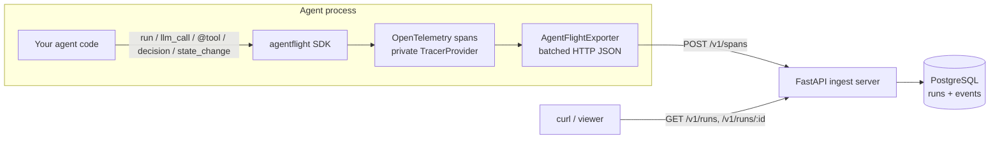

# AgentFlight

A black box recorder for AI agents. AgentFlight records what an agent does during a run:
model calls, tool executions, decisions, state changes, token spend and failures. Every run
is stored as an ordered timeline you can query, and (from week 3) replay.

> Status: early development (week 1, recorder core). APIs may change.

## Architecture



- **One run = one OpenTelemetry trace.** `agentflight.run(...)` opens the root span; its
  trace id is the run id. Everything recorded inside it is a child span.
- **Each span carries `agentflight.*` attributes** (`kind`, model, messages, tokens, tool
  args/result, error type...). Structured values are stored as JSON.
- The SDK uses its **own TracerProvider**, so it doesn't change any global OTel setup your
  app already has.
- The server **upserts by span id** (re-sent batches are idempotent) and accepts child spans
  before their root span arrives (the run shows as `running` until then).

## Quickstart

```bash
# 1. Server + Postgres (applies Alembic migrations on start)
docker compose up --build

# or without Docker, using SQLite:
pip install -e ".[server]"
alembic upgrade head            # uses AGENTFLIGHT_DATABASE_URL, default sqlite:///./agentflight.db
uvicorn agentflight.server.main:app

# 2. Record the toy agent
pip install -e .
python examples/toy_agent.py

# 3. Inspect
curl localhost:8000/v1/runs
curl localhost:8000/v1/runs/<run_id>
```

## Recording API

```python
import agentflight

agentflight.configure("http://localhost:8000")


@agentflight.tool  # records name, bound args, result or exception
def search(query: str) -> list[str]: ...


with agentflight.run("support-agent", metadata={"ticket": 42}) as run:
    with agentflight.llm_call("gpt-4o-mini", messages) as call:
        resp = client.chat(...)  # your model client
        call.record(resp.text, tokens_in=..., tokens_out=..., cost_usd=...)  # cost optional
    agentflight.decision("next_step", "search", reason="needs docs")
    agentflight.state_change("plan", new_plan, old=old_plan)
    try:
        search("refund policy")
    except Exception as exc:
        agentflight.error(exc)  # handled error: recorded, run continues

agentflight.flush()  # before exit, so batched spans are sent
```

- Latency is the span duration (`duration_ms` in the API).
- An exception escaping `run`, `llm_call` or a `@tool` marks that span (and the run) as
  `error` and is re-raised unchanged.
- `@agentflight.tool` works on sync and async functions; `@agentflight.tool(name="...")`
  overrides the name.
- If the server is unreachable, export fails with a logged warning; your agent keeps running.

## HTTP API

| Method | Path | Description |
| --- | --- | --- |
| `POST` | `/v1/spans` | Ingest a batch of spans (`{"spans": [...]}`) |
| `GET` | `/v1/runs` | List runs, newest first (`limit`, `offset`, `status`) with token/cost/error totals |
| `GET` | `/v1/runs/{run_id}` | One run with its events ordered by start time |
| `GET` | `/health` | Liveness |

Interactive docs at `/docs` when the server is running.

## Development

```bash
python -m venv .venv && . .venv/bin/activate
pip install -e ".[dev]"
ruff check . && ruff format --check . && mypy && pytest
```

Tests use in-memory SQLite by default. Set `AGENTFLIGHT_TEST_DATABASE_URL` to a Postgres URL
to run the same suite against Postgres (CI does both).

## Roadmap

- **Week 1: recorder core** (this branch): SDK, OTel exporter, ingest API, Postgres storage,
  migrations, tests, CI.
- **Week 2: integrations.** Auto-instrumentation for OpenAI-style chat clients (tokens and
  usage taken from responses) and LangGraph, plus a sample agent recording real runs.
- **Week 3: deterministic replay and fork.** Re-run a recorded trace step by step, serving
  cached model and tool outputs, and fork a run from any step with changed inputs.
- **Week 4: React viewer and benchmarks.** Run timeline, decision tree, token spend and
  highlighted failures; README screenshots; recorder overhead measured on real runs and
  published with the method used.

## License

MIT
